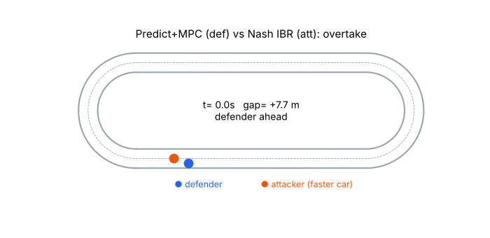
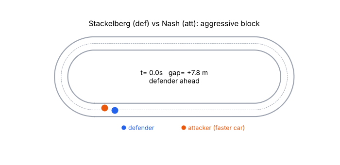
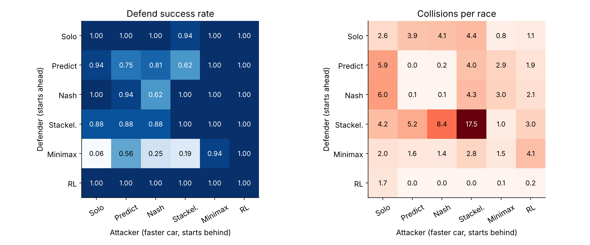
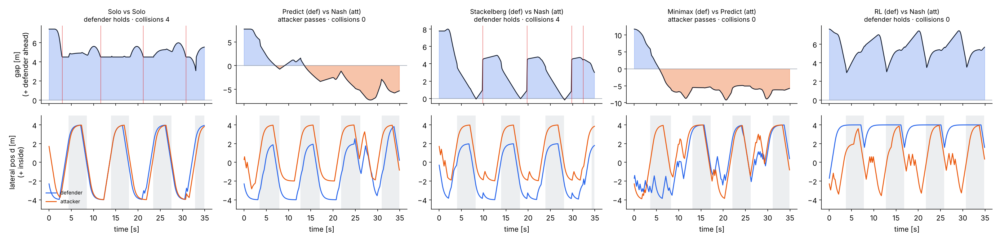
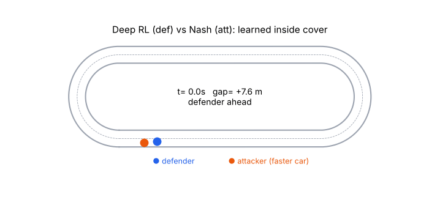

# Game-Theoretic Racing Toy

**English** | [한국어](README_kr.md)

**1v1 autonomous racing, solved six ways: optimal control, predict-then-plan, three game-theoretic solution concepts, and self-play deep RL.**

How you *define* a racing problem decides how you can solve it. This repo puts the main formulations side by side in one small, fast simulator so their behavior can be compared directly: who overtakes, who blocks, and who crashes.

<p align="center">
  
  
</p>

> This is a **toy** built for a seminar. It shows tendencies, not general conclusions. See [Limitations](#limitations).

## The six methods

| Method | Formulation | How the opponent is treated |
|---|---|---|
| Solo MPC | single-agent optimal control | ignored |
| Predict+MPC | predict-then-plan | assumed to keep its lane and speed |
| Nash (IBR) | dynamic game, Nash equilibrium | a rational optimizer; iterated best response |
| Stackelberg | dynamic game, leader–follower | will best-respond to whatever I commit to |
| Minimax (LP) | zero-sum game, security strategy | worst-case adversary; solved as a linear program |
| Deep RL | Markov game, PPO self-play | learned implicitly by playing against itself and past snapshots |

Formulations, inputs, outputs and solvers are explained in [docs/problem_formulation.md](docs/problem_formulation.md).

## Setup

- **Track**: 397 m oval (two 120 m straights, 25 m radius corners), Frenet point-mass model, `dt = 0.1 s`.
- **Defender** (car 0) starts 6–12 m ahead. **Attacker** (car 1) starts behind with a 2.5 m/s higher top speed.
- **Interaction**: collisions slow both cars and put the rear car behind; slipstream gives the car right behind +2 m/s.
- **Common action set**: 10 motion primitives of 2 s (target lateral offset ∈ {−4, −2, 0, 2, 4} m × speed mode ∈ {100%, 85%}), replanned every 0.2 s.
- **Payoff** for player *i* over the 2 s horizon: `U_i = (Δs_i − Δs_j) + 0.2·Δs_i − 30·collision`. Each planner builds a 10 × 10 payoff matrix by simulating every joint primitive pair, then applies its own rule.
- **Tournament**: 6 defenders × 6 attackers × 16 races = 576 races of 35 s (about 2 laps).

## Results



| Method | Defend success | Overtake success* | Collisions / race |
|---|---|---|---|
| Solo MPC | 0.99 | 0.04 | 3.3 |
| Predict+MPC | 0.85 | 0.09 | 2.1 |
| Nash (IBR) | 0.93 | **0.14** | 2.5 |
| Stackelberg | 0.94 | 0.09 | **6.0** |
| Minimax (LP) | **0.50** | 0.00 | 1.9 |
| Deep RL (self-play) | **1.00** | 0.00 | **1.2** |

\* Average over the five non-Minimax defenders. The Minimax defender yields to almost everyone, which would inflate the average. Collisions are averaged over both roles.



**What the toy suggests**

1. **The opponent model is the performance.** The one-way predictor (Predict+MPC) was overtaken most often by the Nash attacker, which reasons about two-way interaction.
2. **The solution concept is the driver's personality.** Stackelberg defends aggressively and makes contact often; Minimax is pessimistic and gives way; Nash sits in between.
3. **Mismatched assumptions are dangerous.** When both cars play Stackelberg, each believes it is the leader: 17.5 collisions per race.
4. **Self-play RL learns the distribution it trains against.** The policy discovered a simple "cover the inside line" defense (perfect defense, fewest collisions) but never learned to overtake: self-play settled into a defense-wins equilibrium within about 30 iterations.

<p align="center"></p>

## Quick start

```bash
git clone https://github.com/jeongsang-ryu/game-theoretic-racing-toy.git
cd game-theoretic-racing-toy
pip install -r requirements.txt

make test         # unit tests (~15 s)
make tournament   # 576 races with the included RL model -> results/results.json
make figures      # regenerate figures/
make train        # retrain the self-play policy -> models/ppo_selfplay.pkl
```

Reference times on 2 CPU cores: training 1,000 iterations ≈ 10 min, tournament ≈ 9 min.
Scripts take arguments, e.g. `python scripts/run_tournament.py --races 32 --workers 8` or `python scripts/train_rl.py --iters 2000 --seed 1`.

## Repository layout

```
racing/
  sim.py         track, dynamics, collisions, slipstream, 10x10 joint rollouts
  agents.py      Solo, Predict, Nash (IBR), Stackelberg, Minimax (LP via scipy HiGHS)
  rl.py          PPO with self-play and a snapshot league (JAX)
  race.py        one race between two agents
  tournament.py  round robin
  viz.py         heatmaps, case plots, GIFs
scripts/         train_rl.py, run_tournament.py, make_figures.py
models/          ppo_selfplay.pkl (pretrained policy)
results/         results.json (the tournament above), train_log.txt
figures/         all figures and GIFs
docs/            problem_formulation.md, problem_formulation_kr.md
tests/           pytest
```

## Limitations

- Point-mass Frenet model; only 10 discrete motion primitives.
- Every planner knows the exact dynamics and the opponent's payoff.
- The 2 s planning horizon is myopic.
- RL: a single seed and about 10 CPU-minutes of training; results depend heavily on the opponent pool.
- 16 races per pair, so cell estimates are noisy (±0.1–0.2 on a rate).

## Where to go next

- Continuous dynamic games: iLQGames, ALGAMES
- Unknown opponent objectives: differentiable game solvers
- Regulation-aware planning (penalize illegal blocking)
- RL leagues and curricula to learn attacking (as in Gran Turismo Sophy)
- Hybrids: learned prediction + game-theoretic planner

## References

- A. Liniger, J. Lygeros, "A Noncooperative Game Approach to Autonomous Racing," *IEEE TCST*, 2020.
- M. Wang et al., "Game-Theoretic Planning for Self-Driving Cars in Multivehicle Competitive Scenarios," *IEEE T-RO*, 2021.
- D. Fridovich-Keil et al., "Efficient Iterative Linear-Quadratic Approximations for Nonlinear Multi-Player General-Sum Differential Games," *ICRA*, 2020.
- S. Le Cleac'h, M. Schwager, Z. Manchester, "ALGAMES: A Fast Solver for Constrained Dynamic Games," *RSS*, 2020.
- P. Wurman et al., "Outracing champion Gran Turismo drivers with deep reinforcement learning," *Nature*, 2022.
- X. Liu, L. Peters, J. Alonso-Mora, "Learning to Play Trajectory Games Against Opponents with Unknown Objectives," *RA-L*, 2023.
- S. Boyd, L. Vandenberghe, *Convex Optimization*, Ch. 4–5.

## License

MIT
